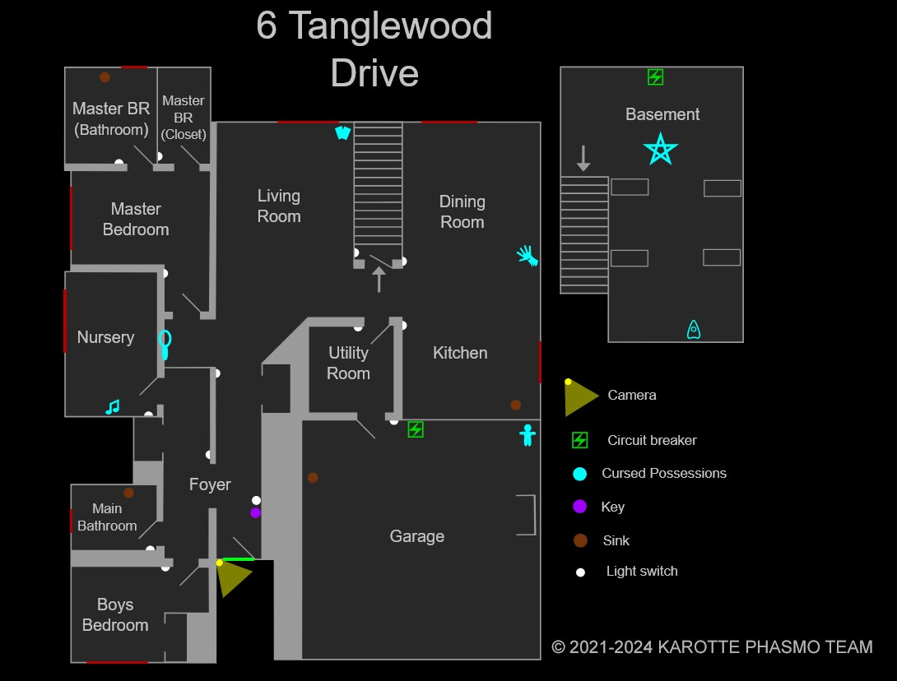

# THE HOUSE IS WATCHING — PROJECT CONTEXT FOR CLAUDE

> **Purpose:** This document is the canonical creative and technical context for developing *The House Is Watching*. Read it before changing or generating project code. It is intended to be used as `CLAUDE.md` in the project root or uploaded as project context.
>
> **Working title:** The House Is Watching (not final).
>
> **Game type:** Single-player, first-person, continuous-story psychological survival horror for desktop browsers.

---

## 0. HOW TO USE THIS DOCUMENT

This document records the current project direction, including decisions, proposals and unresolved questions. It is not permission to invent missing story canon.

### Status labels

- **CONFIRMED** — explicitly established by the user.
- **PROPOSED** — discussed as a useful design or implementation suggestion, but not explicitly approved as final canon.
- **UNDECIDED** — must remain configurable or be left open until the user decides.
- **REJECTED / SUPERSEDED** — an earlier direction that must not be used for the current project.

When a detail is not established, do not silently turn a suggestion into canon. Use editable configuration and sensible temporary placeholders, and identify the decision as pending.

### Priority order when instructions conflict

1. The user's newest explicit instruction in the active conversation.
2. Confirmed decisions in this document.
3. Proposed design guidance in this document.
4. Claude's own implementation preferences.

The user may revise this document's direction at any time. Apply new instructions without preserving an older conflicting choice.

### Working style

- Inspect the existing repository before editing it.
- Preserve working code and existing architecture unless there is a clear reason to change it.
- Implement incrementally and test each meaningful system.
- Do not claim a feature works unless it has been run and verified.
- Do not fabricate assets, tests, build results or deployment success.
- Avoid asking questions that can be resolved by this document. Ask only when an unresolved decision materially blocks implementation.
- Where possible, build a playable, coherent version rather than a collection of disconnected prototypes.

---

# 1. PROJECT SUMMARY

## 1.1 Core premise — CONFIRMED

The player controls a kidnapped child, approximately **10–13 years old**, who awakens in the basement of an isolated old mansion. The child must escape the basement, navigate the house and its grounds, avoid the occupant, discover clues about the occupant's identity and history, and ultimately reach an underground sewer.

The occupant is a human child kidnapper. The game should conceal the occupant's real identity until the final cinematic. Before that reveal, players should find specific but ambiguous clues that gradually make them suspicious without allowing them to be completely certain.

The game is primarily about:

- Navigating and exploring the house and property.
- Evading the occupant.
- Feeling watched, including when the occupant is not actively nearby.
- Finding and interpreting pieces of evidence.
- Escaping and surviving.

## 1.2 Format and presentation — CONFIRMED

- Single-player.
- First-person perspective.
- Browser-based game.
- One continuous playable experience.
- Story-driven psychological survival horror.
- The environment should be explored in one uninterrupted run, without conventional level-selection or level-completion screens between areas.

The development team may refer to areas as stages or sequences during planning, but these are not separate gameplay levels. The basement, mansion, exterior grounds and sewer should feel physically connected.

## 1.3 Working title — PROPOSED

**THE HOUSE IS WATCHING** is the current working title. It is not final and can be changed by the user.

## 1.4 Intended emotional experience — CONFIRMED CREATIVE DIRECTION

The game should feel serious, tense, oppressive and unsettling. It should not become a goofy ghost-hunting game, an action shooter or a conventional monster-chase game.

The player should feel vulnerable because the protagonist is a child. The player should frequently feel observed or unsafe even when the antagonist is not visible.

---

# 2. INSPIRATIONS AND DESIGN PRINCIPLES

The user cited the following games as inspirations:

### Alien: Isolation

Use as inspiration for:
- A persistent human threat that searches and patrols.
- Hiding and evasion.
- Sound-based detection.
- The feeling that the player is not safe simply because the antagonist is out of sight.
- Tension created by uncertainty about the antagonist's location.

### Poppy Playtime

Use as inspiration for:
- Escalating tension.
- A high-intensity final chase.
- Strong pacing during the climactic sequence.

### Amnesia: The Dark Descent

Use as inspiration for:
- Oppressive atmosphere.
- Vulnerability and limited ability to fight back.
- Exploration and environmental storytelling.
- Psychological tension and careful use of darkness and sound.

**Originality requirement:** These titles are references for broad design principles only. Do not copy their characters, maps, dialogue, models, textures, audio, branding or distinctive protected content.

## 2.1 Core design pillars

1. **Vulnerability:** The protagonist is a child and should not behave like a trained fighter.
2. **Paranoia:** The player should feel watched even when the antagonist is absent.
3. **Exploration:** Rooms and objects should tell parts of the story.
4. **Stealth and evasion:** Avoiding detection is more important than fighting.
5. **Escalation:** The tension should build towards a fast, frightening sewer chase.
6. **Revelation:** The final cinematic should connect the clues and reveal the antagonist's identity and previous victims.
7. **Feasible implementation:** Prioritize a complete, stable game over an oversized collection of unfinished features.

---

# 3. STORY AND NARRATIVE CANON

## 3.1 Protagonist — CONFIRMED / UNDECIDED DETAILS

**Confirmed:**
- The protagonist is a child approximately 10–13 years old.
- The protagonist has been kidnapped.
- The player experiences events from the child's first-person perspective.
- The child is vulnerable and does not have normal combat capabilities.

**Undecided:**
- Name, gender, appearance and voice.
- Family background and life before the kidnapping.
- Exact circumstances of the kidnapping.
- Whether the kidnapping was random or connected to something in the child's past.
- Whether the protagonist speaks during gameplay.

Do not invent these details as permanent story facts.

## 3.2 Antagonist — CONFIRMED / UNDECIDED DETAILS

**Confirmed:**
- The antagonist is a human child kidnapper.
- They are the occupant of the isolated property.
- Their real identity as a child kidnapper must be revealed only in the final cinematic.
- Earlier clues should be specific enough to create suspicion but ambiguous enough that the player cannot be completely certain.
- The antagonist is an active physical threat who can search for and pursue the protagonist.

**Undecided:**
- Name and public identity.
- Profession and public reputation.
- Age and appearance.
- Motive and detailed history.
- Whether they appear respectable to the surrounding community.
- Their exact voice, dialogue and mannerisms.

The antagonist should feel like a believable human being, not a supernatural monster or an exaggerated slasher villain. The user has not finalized whether the antagonist has an established profession or respectable public identity.

## 3.3 Story progression — CONFIRMED HIGH-LEVEL ORDER

The experience follows one continuous sequence:

### Sequence 1 — Awakening in the basement

The child wakes in the basement of the property. The immediate objective is to find a way out. This section introduces movement, looking, interaction and basic environmental exploration.

### Sequence 2 — Exploring the mansion

The child reaches the main house and explores interconnected rooms. They discover documents, photographs, belongings and other environmental clues. These should gradually imply that other children may have been connected to the property.

### Sequence 3 — The occupant becomes a threat

The antagonist becomes an active threat. The player must avoid being seen or heard, hide when necessary and use knowledge of the house to evade them. The player should not be chased constantly; searching, patrolling and uncertainty are central to the experience.

At some point before the final chase, the child discovers a firearm in a room. The child does not know how to use it and does not use it as a normal gameplay weapon.

### Sequence 4 — Exterior escape attempt

The child gets out of the house and moves through the grounds. The player finds an entrance to an underground sewer or drainage tunnel.

### Sequence 5 — Sewer chase

The antagonist follows the child into the sewer. A fast-paced, high-pressure chase begins. The player must run forward through a straight tunnel while the antagonist pursues from behind.

### Sequence 6 — Final confrontation and blackout

The chase ends in a confrontation. The child uses the firearm discovered earlier. The screen cuts to black immediately before the gunshots. **Three gunshots are heard.**

Do not add an ordinary shooting gameplay system. The use of the firearm is a scripted story moment.

### Sequence 7 — Final revelation cinematic

After the three gunshots, the final cinematic reveals the antagonist's true identity as a child kidnapper and exposes their previous victims. The previous victims were killed by the antagonist, and their remains were found.

The cinematic should connect the evidence the player encountered during exploration and explain the significance of the clues.

**Undecided:** The exact visual format of the cinematic, names of victims, exact number of victims, dates, the antagonist's real name, the role of police/investigators, and how much of the protagonist's immediate aftermath is shown. Do not fabricate these details.

## 3.4 Clue design — DIRECTION CONFIRMED, EXACT CLUES UNDECIDED

The clue system should create suspicion without prematurely revealing the antagonist's identity.

Possible clue categories already discussed:

- Newspaper clippings about missing children.
- Altered, scratched or removed faces in photographs.
- Children's belongings in unexpected rooms.
- Evidence of previous confinement.
- Disturbing but non-graphic evidence of crimes.
- Personal records containing partial names, dates or references.
- Signs that someone tried to conceal evidence.

These are candidate clue types, not a finalized list or fixed placement plan.

A suggested progression is:

1. **Unease:** Evidence that the house has been occupied by children or contains traces of previous visitors.
2. **Suspicion:** Missing-person reports or altered photographs suggest a connection to disappearances.
3. **Stronger suspicion:** Belongings and records imply that children were held at the property.
4. **Near-revelation:** Documents suggest a pattern of crimes but do not clearly name the occupant.
5. **Final revelation:** The cinematic identifies the antagonist and reveals the previous victims and their fate.

Clues should ideally be discoverable through exploration. Optional clues may enrich the player's understanding, but the player must not become permanently unable to finish because they missed an optional document. The core route and ending should remain completable.

## 3.5 Graphic-content boundary — CONFIRMED

The user wants a serious, mature horror tone. Appropriate environmental details may include:
- Blood stains.
- Previously used weapons or tools associated with crimes.
- Disturbing evidence of previous victims.
- Abandoned personal belongings.
- Missing-person reports and crime-related documents.
- Signs of attempted cleanup or concealment.

The user described the desired graphic level as limited, with blood stains and previously used murder weapons as examples. Prefer environmental implication and atmosphere over explicit gore or prolonged depictions of violence. The final shooting is communicated through a blackout and three gunshots, not a detailed shooting animation.

---

# 4. HORROR AND ATMOSPHERE

## 4.1 Psychological + realistic + supernatural-looking ambiguity — CONFIRMED

The desired experience combines:
- Realistic human-threat horror.
- Psychological horror.
- A small amount of supernatural-looking presentation.

**There must not be a confirmed supernatural entity or direct supernatural gameplay system.** The game should only create the appearance of unexplained events in selected moments.

Possible techniques:
- Flickering lights.
- A dark silhouette at the far end of a corridor.
- A figure visible briefly in the background that is gone when the player looks again.
- A door that appears to have moved or opened.
- An object that seems to have changed position.
- Distant footsteps, breathing or indistinct sounds.
- A room that feels occupied even when it appears empty.

Events may have ordinary explanations, may be caused deliberately by the antagonist, or may remain ambiguous. Do not explain every event. Do not make the protagonist hallucinate constantly or add a complex sanity meter unless the user explicitly requests it.

## 4.2 The feeling of being watched — HIGH PRIORITY

This is a defining feature of the game.

The player should feel observed even when the antagonist is not actively chasing or monitoring them.

Use a combination of:
- Environmental composition and sightlines.
- Partially open doors.
- Dark doorways and distant silhouettes.
- Windows and observation-like angles.
- Occasional movement in peripheral vision.
- Audio cues suggesting activity elsewhere.
- Small changes to the environment.
- The antagonist's presence implied by recently used objects or interrupted routines.

Do not overuse these events. They are most effective when infrequent and unpredictable.

## 4.3 Audio direction — PROPOSED

Suggested audio layers:
- Ambient mansion room tone.
- Floorboards and structural creaks.
- Distant footsteps.
- Door and drawer sounds.
- Light electrical buzz and flicker sounds.
- Distant outdoor wind and trees.
- Water dripping and reverberation in the sewer.
- Antagonist footsteps and breathing during pursuit.

Audio should support spatial awareness and tension. Avoid constant music or loud stingers that remove the impact of silence.

---

# 5. WORLD AND ARCHITECTURE

## 5.1 Mansion reference image — IMPORTANT

The user supplied a floor-plan image labelled **“6 Tanglewood Drive”** as the architectural reference. A copy is included with this context package:

`reference/tanglewood_floorplan_reference.jpg`

Use the image for the **general room arrangement, relative placement and connectivity** of the house. It is an architectural reference, not an instruction to reproduce the original game's branding, UI or gameplay markers.

Do not copy the Phasmophobia map title, logo, copyright notice, legend or coloured gameplay markers. The camera, circuit breaker, cursed possession, key, sink and light-switch icons are not part of this game's required layout. The coloured overlay symbols are not room geometry.

The reference image shows a main-floor plan and a separately drawn basement plan. The basement is a lower floor of the same property, not a separate building.

## 5.2 Main-floor room arrangement — CONFIRMED REFERENCE

Preserve the approximate relative position and adjacency of the following rooms:

| Reference area | Position / relationship |
|---|---|
| Master bathroom | Upper-left, attached to the master-bedroom area |
| Master closet | Upper-left, next to the master bathroom |
| Master bedroom | Left side, below the bathroom/closet area |
| Nursery | Left-middle, below the master-bedroom area |
| Living room | Upper-middle, to the right of the master-bedroom area |
| Main staircase | Near the upper-middle, between the living and dining areas; use as the main vertical connection to the basement where appropriate |
| Dining room | Upper-right, adjacent to the living room and kitchen |
| Utility room | Central area, below the living/dining region |
| Kitchen | Right-middle, below the dining room and beside the utility area |
| Foyer | Lower-middle / lower-left central circulation area |
| Main bathroom | Lower-left, near the foyer and boys' bedroom |
| Boys' bedroom | Bottom-left, below the main bathroom |
| Garage | Large lower-right area, connected to the house through the lower central/utility side |

The precise dimensions and exact door positions are not supplied. Claude may choose coherent dimensions and doorway details, but must preserve the overall arrangement and room relationships.

### Important clarification about floors

The supplied architectural image depicts the main floor and a separate basement plan. It does **not** establish a separate upper storey. Do not invent an additional upper floor as part of the main mansion unless the user later requests it. The required structure is the main-floor arrangement shown plus the basement beneath it.

## 5.3 Basement — REFERENCE-BASED

The basement is shown separately in the reference image. Build it as a real lower floor connected to the mansion by the staircase.

The basement is the player's starting location.

Its broad reference characteristics:
- Large, mostly rectangular underground space.
- Staircase positioned along one side.
- Concrete or masonry walls and floor.
- Storage furniture or shelving.
- Support structures and a few enclosed/partially enclosed areas.

The exact object placement is open to design.

### Basement atmosphere

- Cold, weak lighting.
- Concrete and aged materials.
- Limited visibility.
- Subtle ambient sound.
- A confined, neglected feeling.

The player must be able to navigate the basement and find a plausible way to reach the main house.

## 5.4 Exterior grounds — USER GRANTED DESIGN FREEDOM

The user explicitly left the exterior grounds layout to the assistant/developer's design expertise. The exterior should be an original, compact estate environment that connects the mansion to the sewer entrance.

A recommended arrangement (PROPOSED, not fixed):

- Front driveway or approach, partly overgrown.
- Rear patio or concrete landing connected to an exterior mansion door.
- Overgrown garden with tall grass, shrubs, dead plants and uneven paths.
- Narrow side path around the building.
- Optional small garden shed or utility structure.
- Old perimeter fence, dense trees and vegetation establishing isolation.
- A concealed sewer/drainage entrance near a retaining wall, drainage structure or overgrown corner.

The grounds should be explorable but compact. This is not an open-world game. Use fencing, dense vegetation, trees, walls or terrain to constrain the playable area naturally.

The player should not be able to simply walk away into an infinite landscape.

## 5.5 Sewer — USER'S SPECIFIC DESIGN REQUIREMENTS

The sewer is a high-priority, very specific environment.

**Required layout:**
- One long, straight tunnel.
- Narrow and claustrophobic.
- No branching passages.
- No maze.
- No confusing route choices.
- No unnecessary side rooms.
- One forward path that supports the final chase.

**Required visuals:**
- Concrete walls and floor.
- Low or curved ceiling.
- Pipes and drainage details.
- Wet surfaces and occasional puddles.
- Limited debris that does not obstruct the player unfairly.

**Required visibility and lighting:**
- Extremely dark.
- The player should see only approximately 2–3 metres ahead.
- Use a weak forward-facing light/flashlight and very limited ambient illumination.
- The player must still be able to turn around and see the kidnapper pursuing them.
- When seen behind the player, the antagonist should be readable as a moving human silhouette, subtly illuminated by controlled/back lighting or a carefully placed light source.
- Do not make the antagonist glow or appear supernaturally illuminated.
- The tunnel itself must remain dark.

**Required chase behaviour:**
1. The player enters the sewer.
2. The antagonist follows into the tunnel.
3. The chase begins as a scripted gameplay sequence.
4. The player sprints forward.
5. The antagonist approaches from behind.
6. Turning backwards allows the player to glimpse the antagonist pursuing them.
7. Footsteps and breathing grow louder as the antagonist gets closer.
8. The player reaches the final confrontation at the end of the run.

Keep the run essentially straight. A small terminal confrontation area may be used only if necessary, but do not add branches or maze-like sections. Avoid stopping the player for complicated puzzles during the chase.

The chase must be difficult but fair. Do not let the antagonist catch the player immediately after the sequence begins. Provide a clear restart/checkpoint policy when the chase is lost; the exact checkpoint design is open.

---

# 6. GAMEPLAY SYSTEMS

The systems below reflect the current design direction. Items marked PROPOSED should be treated as implementation recommendations, not immutable story canon.

## 6.1 Player controls — PROPOSED DEFAULTS

Suggested desktop controls:

| Input | Action |
|---|---|
| W / A / S / D | Move |
| Mouse | Look around |
| Shift | Sprint |
| Ctrl | Crouch |
| E | Interact |
| F | Toggle flashlight |
| Esc | Pause / release pointer lock |

Use a clear, configurable input map so controls can be changed without rewriting gameplay logic.

The player should have smooth first-person movement, sensible acceleration/deceleration and reliable collision.

Sprinting should be faster but louder. Crouching should be slower and quieter.

## 6.2 Interaction system — PROPOSED

Use a centre-screen raycast from the camera to detect interactable objects within a configurable range.

Possible interactions:
- Open/close doors.
- Open drawers and cupboards.
- Collect keys or important items.
- Inspect objects.
- Read documents.
- Operate switches.
- Enter and exit hiding places.
- Trigger the sewer entrance and story events.

Show a small contextual interaction prompt only when the player is looking at a valid object within range.

Doors must animate around appropriate hinges. Door collision must update when the door opens or closes. Do not permit interaction through walls or from implausible distances.

## 6.3 Inventory and clue journal — PROPOSED

A minimal inventory is sufficient. It may track keys and required objects without implementing a complex grid inventory.

A journal or evidence interface may record documents and clues already discovered. It should be simple and readable, with minimal screen obstruction.

Keep narrative text in data/configuration files rather than hardcoding it throughout the UI logic.

## 6.4 Puzzles and progression — PROPOSED

The game should use a small number of straightforward environmental puzzles rather than complex puzzle chains.

Candidate progression gates:
- A simple key/mechanism puzzle to escape the basement.
- One mansion obstacle or locked access route.
- A requirement or discovery that leads the player towards the exterior and sewer entrance.

The exact puzzles and their solution sequences are UNDECIDED. Keep them configurable and avoid inventing elaborate puzzle lore.

## 6.5 Objectives — PROPOSED

Use a minimal objective display that changes as the story progresses. Do not reveal all future events to the player.

Candidate objective wording:
- Find a way out of the basement.
- Explore the house.
- Find a way through the locked area.
- Avoid the occupant.
- Find a way outside.
- Reach the underground passage.
- Get through the tunnel.

Exact wording can be edited later.

## 6.6 Hiding — PROPOSED

Potential hiding places:
- Wardrobes.
- Under beds.
- Storage cupboards.
- Behind suitable large furniture.

Implement a small number of hiding types reliably before attempting every possible hiding spot. Hiding should have a clear enter/exit interaction and should prevent the antagonist from detecting the player when properly concealed, subject to the final detection design.

## 6.7 Sound and stealth — PROPOSED

Use event-based noise generation rather than complex real-time audio analysis.

Suggested relative noise levels:

| Player action | Relative noise |
|---|---|
| Crouch-walking | Low |
| Normal walking | Low–medium |
| Sprinting | High |
| Dropping or knocking an object | High |
| Noisy door interaction | Medium–high |

Each noise event can have a position, intensity and detection radius. The antagonist should investigate the event's location rather than magically knowing the player's exact current position.

## 6.8 Combat — CONFIRMED RESTRICTION

There is no conventional combat system.

The firearm is discovered before the sewer chase. The protagonist does not know how to use it and does not use it during ordinary exploration or stealth.

It is used only in the final scripted confrontation. Do not build weapon aiming, ammunition, weapon switching or regular enemy combat unless the user later changes this direction.

---

# 7. ANTAGONIST AI

## 7.1 General behaviour — CONFIRMED DIRECTION

The antagonist should not constantly chase the player. The player should spend more time anticipating or fearing the antagonist than directly seeing them.

The antagonist is a human occupying the property. Their behaviour should feel deliberate and grounded.

Examples of presence without direct pursuit:
- A recently used cup or object.
- A chair moving slightly.
- A television or light left on.
- Footsteps from another room.
- The antagonist briefly visible at a distance.
- A door that changes state after the player leaves an area.

## 7.2 Finite-state machine — PROPOSED

Use a configurable state machine with these candidate states:

1. **PATROLLING** — moves between predetermined waypoints and follows a routine.
2. **INVESTIGATING** — moves towards a suspicious sound or disturbance.
3. **SEARCHING** — searches nearby rooms or locations after losing sight/hearing of the player.
4. **PURSUING** — actively follows the player after visual confirmation or another approved trigger.
5. **LOST TARGET** — searches the last known player position, then returns to patrol when appropriate.

Use clean state transitions and avoid overlapping behaviours that cause the antagonist to jitter, teleport or switch states every frame.

## 7.3 Visual detection — PROPOSED

Use configurable:
- Detection distance.
- Field-of-view angle.
- Line-of-sight checks.
- Occlusion by walls and doors.
- Detection time or alert accumulation, if useful.

The antagonist must not see through solid walls or closed doors.

## 7.4 Navigation — PROPOSED

The house has a known, finite layout. A waypoint graph or lightweight navigation solution may be sufficient. Do not introduce an expensive or complicated navigation framework without need.

The antagonist should not walk through walls, furniture or closed doors. Ensure patrol routes and investigation targets are reachable.

## 7.5 Search and hiding interaction — PROPOSED

The antagonist may check a limited number of plausible hiding places when searching. Do not have them magically inspect every location in the house instantly.

The player should have a fair opportunity to escape or remain concealed. Detection, search duration, movement speed and catch distance should be configurable for balancing.

## 7.6 Scripted appearances vs active AI — IMPORTANT DISTINCTION

Not every silhouette or distant figure needs to be the actual antagonist AI.

Use a separate horror-event system for scripted visual/audio events. This allows background silhouettes and environmental disturbances to occur without forcing the active antagonist to physically navigate to every scare location.

---

# 8. HORROR EVENT DIRECTOR

A lightweight event director is recommended to manage rare atmospheric incidents.

Potential events:
- A light briefly flickers.
- A distant silhouette is visible for a moment.
- A door is found slightly open.
- A sound occurs in a neighbouring room.
- An object appears to have shifted.
- A distant footstep or faint breathing sound plays.

Rules:
- Events must be infrequent.
- Do not trigger several scares back-to-back.
- Do not make every event a jump scare.
- Do not obstruct mandatory progression.
- Avoid repeated identical events that make the experience predictable.
- Keep the explanation ambiguous where appropriate.
- Do not add an actual ghost or confirmed supernatural enemy.

---

# 9. FINAL CHASE AND ENDING

## 9.1 Chase — CONFIRMED

The sewer chase is the climax of the game. It should be faster and more intense than the preceding exploration.

The environment must remain a straight, narrow, dark tunnel. The player moves forward while the antagonist follows behind. The player can look backwards and glimpse the pursuing antagonist.

No maze, branching route or complicated puzzle should interrupt the chase.

## 9.2 Firearm payoff — CONFIRMED

The firearm has been found earlier in the mansion. It is not used during normal gameplay. Its purpose is narrative foreshadowing and the final confrontation.

## 9.3 Blackout and three gunshots — CONFIRMED

The user specified the sequence:

1. Final confrontation.
2. The child uses the firearm against the antagonist.
3. Screen cuts to black immediately before the shots are heard.
4. Three gunshots are heard.
5. Final cinematic begins.

Do not depict a detailed shooting animation. The blackout and three distinct shots are part of the intended presentation.

## 9.4 Final cinematic — CONFIRMED CORE REVELATION

The cinematic reveals:
- The antagonist's real identity.
- That the antagonist is a child kidnapper.
- Their previous victims.
- That the previous victims were murdered by the antagonist.
- That the victims' remains were found.

The final cinematic should make the earlier clues meaningful in retrospect.

Exact identities, dates, documents, police details, number of victims and the protagonist's immediate fate remain undecided. Keep the ending content editable in a dedicated data file or cinematic script.

---

# 10. TECHNICAL IMPLEMENTATION DIRECTION

## 10.1 Target and time constraint — CONFIRMED

- The game is web-based.
- The team intends to use Claude Pro to assist with implementation and debugging.
- The target is to have a complete playable game, debug it and deploy it to GitHub within a **five-hour hackathon build window**.
- The user wants to do the design and prompt/context preparation before the hackathon so that the five hours are spent executing and testing rather than deciding the game design.

Do not artificially shrink the creative ambition solely because the event is five hours. Instead, design a complete experience and make implementation choices that keep the five-hour execution realistic.

## 10.2 Recommended stack — PROPOSED, NOT USER-CONFIRMED

Default recommendation:
- Three.js for 3D rendering.
- Vite for local development and production build.
- Vanilla JavaScript with ES modules.
- HTML and CSS for UI.
- GitHub Pages as a possible static hosting target.

Before scaffolding, inspect the repository. If a working project already exists with a different suitable stack, preserve it rather than migrating without a compelling reason.

The user has not explicitly approved this stack as final.

## 10.3 Architecture principles

Keep the code modular. Suggested subsystems:

- Game initialization and main loop.
- Game state and progression manager.
- Input manager.
- Player controller.
- Player collision.
- Interaction/raycast system.
- World/environment builder.
- Door and object interaction.
- Antagonist AI and navigation.
- Stealth/sound event system.
- Hiding system.
- Inventory and clue journal.
- Horror event director.
- Audio manager.
- UI manager.
- Cinematic manager.
- Story, clue and ending data.

This is a conceptual module list. Do not create unnecessary files or abstractions if the implementation remains small. Keep responsibilities separated enough that one feature can be tested without rewriting the entire game.

## 10.4 Asset strategy — PROPOSED

Because the hackathon build window is short:
- Prefer locally available assets and procedural geometry where practical.
- Use simple but cohesive materials and lighting rather than waiting on complex assets.
- Use reusable geometry for walls, floors, door frames, furniture and environmental props.
- Keep texture sizes reasonable.
- Avoid runtime dependencies on external APIs or assets that may fail to load.
- If using external asset packs, verify licensing and include the assets locally.
- Do not use placeholder rectangles for critical interactions or pretend unimplemented systems are complete.

## 10.5 Performance

Target ordinary desktop browsers and gaming laptops, not high-end-only hardware.

Recommended practices:
- Reuse materials and geometry.
- Use instancing where appropriate.
- Limit real-time shadow-casting lights.
- Keep post-processing modest.
- Avoid unnecessarily high texture resolutions.
- Reuse modular room geometry.
- Dispose of unused resources where appropriate.
- Prevent expensive per-frame scans across every object when an event-based approach will work.

## 10.6 Collision and navigation — HIGH PRIORITY

Collision reliability is essential. The player must not phase through:
- Exterior or interior walls.
- Windows.
- Floors.
- Ceilings and roofs.
- Closed doors.
- Large furniture and major obstacles.
- Sewer walls and boundaries.

The player must be able to traverse stairs and room connections reliably.

Keep visual meshes and collision geometry conceptually separate. Door collision must update correctly when a door opens or closes. Do not rely only on visual appearance to infer collision.

The antagonist must also respect walls, doors and navigation boundaries.

## 10.7 Continuous world

Do not implement the mansion, exterior and sewer as unrelated selectable levels. Build them as one connected environment or use seamless internal streaming only if genuinely necessary. The player should experience natural transitions through doors, staircases and the sewer entrance.

---

# 11. USER INTERFACE AND GAME FLOW

The exact interface design is UNDECIDED. A restrained, immersive presentation is preferred.

Suggested elements:
- Minimal title/start screen.
- Mouse pointer-lock instruction.
- Small central interaction prompt.
- Minimal crosshair or reticle, if needed for interaction.
- Optional current objective text.
- Simple inventory / clue journal.
- Pause menu and restart option.
- Basic audio/settings controls if feasible.
- A restrained death/retry interface.

Avoid a large conventional HUD. Do not display a health bar unless later approved. A conventional health system has not been established.

The game should include an understandable start flow and a complete ending flow. Ensure the pointer lock is correctly requested from a user gesture and can be released safely.

---

# 12. TESTING AND ACCEPTANCE CRITERIA

A feature is not complete merely because it has code or looks correct in a screenshot. Test it in the running game.

## 12.1 Project/build checks

- Development server starts.
- Browser loads without fatal console errors.
- Production build succeeds.
- Production asset paths work under a repository subpath if deploying to GitHub Pages.
- No essential external network dependency prevents the game from starting.

## 12.2 Player checks

- WASD movement works.
- Mouse look works.
- Sprint and crouch work if implemented.
- Player cannot pass through walls, windows, floors, ceilings or closed doors.
- Stairs are traversable.
- Flashlight works if implemented.
- Interaction prompts appear only for valid nearby objects.

## 12.3 Environment checks

- Main-floor room arrangement resembles the reference.
- Rooms are physically connected as intended.
- Basement is below and connected to the main floor.
- No unintended invisible wall blocks a doorway.
- No unnecessary passable wall obstructs the view or navigation.
- Exterior boundaries are clear.
- Sewer entrance is reachable.
- Sewer is straight and has no unintended branches.

## 12.4 Gameplay checks

- Player can escape the basement.
- Required progression interactions work.
- Clues can be collected/read.
- Antagonist can patrol and investigate.
- Antagonist responds to sound and sight in a fair, understandable way.
- Hiding works if implemented.
- Player can reach the exterior.
- Sewer chase starts correctly.
- Antagonist pursues from behind and can be seen when the player looks back.
- Chase failure and restart work.
- Final confrontation and blackout sequence trigger.
- Three gunshots play in the correct order.
- Final cinematic plays and reveals the required information.

## 12.5 Debugging discipline

When a bug is reported:
1. Reproduce it.
2. Identify the responsible system and likely cause.
3. Fix the smallest appropriate part of the implementation.
4. Retest the original case.
5. Test adjacent cases that could have been affected.
6. Confirm the fix rather than merely assuming it.

Do not rewrite unrelated functioning systems to address a localized bug.

---

# 13. DELIVERY AND GITHUB DEPLOYMENT

GitHub is the required source-control/delivery destination. GitHub Pages is the proposed browser-hosting target unless the user selects another deployment method.

Before deployment:
- Verify the production build.
- Configure the correct Vite base path for the repository URL.
- Ensure asset URLs work when hosted in a subdirectory.
- Ensure the game does not depend on local development-only paths.
- Test the built output locally where possible.
- Include clear README instructions.
- Do not commit secrets, private tokens or unnecessary large temporary files.

If using GitHub Actions, configure a workflow to build and deploy the production output to GitHub Pages. Do not claim that deployment is live unless the workflow has run successfully and the deployed URL has been checked.

---

# 14. DECISIONS STILL OPEN

These items must remain editable or be raised with the user before being treated as final canon:

### Narrative
- Final title.
- Protagonist name, gender, appearance and backstory.
- Antagonist name, appearance, public identity, profession and motive.
- Exact kidnapping circumstances.
- Exact clue texts and placements.
- Exact identity and history revealed in the final cinematic.
- Number and names of previous victims.
- Exact depiction of the post-shooting aftermath.
- Dialogue and voice acting.

### Level/world design
- Exact room dimensions and coordinate scale.
- Final door and window positions.
- Exact furniture and prop placement.
- Exact exterior ground layout.
- Exact sewer length and final endpoint geometry.
- Exact hiding-place locations.

### Gameplay
- Exact puzzle logic and item/key dependencies.
- Whether clues are all optional or some are required.
- Exact patrol routes and AI tuning.
- Detection thresholds and catch conditions.
- Checkpoint and death/restart policy.
- Whether flashlight battery management exists.
- Exact gameplay duration and difficulty.

### Technical
- Final engine/framework approval.
- Whether a suitable existing repository already exists.
- Exact asset sources and licenses.
- Final hosting method and repository name.

---

# 15. REJECTED OR SUPERSEDED DIRECTIONS

The following must not be used for the current version:

- **Co-op / Phasmophobia-style multiplayer:** rejected for the current project. The user returned to the original single-player story-mode game.
- **Separate selectable levels:** not desired. The game should be a continuous experience.
- **Direct supernatural entity or confirmed paranormal activity:** not desired. Supernatural-looking visual/audio ambiguity is acceptable, but no real ghost or supernatural gameplay system has been approved.
- **Conventional combat:** not desired. The firearm is a one-time narrative payoff during the final confrontation.
- **Complex maze-like sewer:** explicitly not desired. The sewer chase is a straight run with minimal lighting.
- **An extra mansion upper floor:** not established by the supplied floor-plan reference. The reference shows a main-floor plan plus a basement plan. Do not invent another storey without approval.

---

# 16. IMMEDIATE IMPLEMENTATION GUIDANCE FOR CLAUDE

When first entering the project:

1. Read this entire document.
2. Inspect the repository and report the current state.
3. Identify the existing framework, scripts, assets and build/deployment configuration.
4. Preserve working code and avoid unnecessary migration.
5. Compare the current world layout with `reference/tanglewood_floorplan_reference.jpg` if the image is available.
6. Propose a short, ordered implementation plan based on the actual repository.
7. Implement in verifiable milestones: project boot, player/collision, mansion layout, interactions/progression, antagonist AI, horror events, exterior, sewer chase, ending, QA and deployment.
8. Run the game and production build at meaningful milestones.
9. Maintain a concise list of completed features, known bugs and unresolved design decisions.
10. Never convert proposed or undecided story material into permanent canon without user approval.

**Overall goal:** Deliver a complete, continuous, atmospheric first-person horror game in which a kidnapped child explores an isolated mansion, feels persistently watched, evades a human kidnapper, uncovers clues, escapes through the grounds into a dark straight sewer, survives a final chase and reaches a blackout ending with three gunshots followed by a cinematic revelation of the antagonist's identity and previous victims.

---

# 17. DECISIONS ADDED DURING DEVELOPMENT

## 17.1 Antagonist — CONFIRMED (user, development update 2)

- Name: **Chris Charles**. Age 36. Height 175 cm. Muscular build. Male.
- He was severely abused as a child. As an adult he became obsessed with children he saw as genuinely happy. He kidnapped and murdered them, dismembered them in the basement and left their remains in different places.
- His name and face must never be shown during play. The final cinematic reveals his identity.
- Tell the backstory mainly through environmental storytelling: the map (red circles for where children were taken, red X marks for where remains were left), the basement cleaver and drain, the cage, the photographs, notes, and the old case letter.

## 17.2 PROVISIONAL (implemented, awaiting user confirmation)

- Number of victims: 6. Town and place names on the map are fictional and invented.
- Exact wording of every clue and ending card (`src/data/story.js`). No victim is named.
- He comes home about 6 s after the child leaves the basement.
- Four hiding places: the closet wardrobe, the nursery wardrobe, the boys' wardrobe and the garage cupboard.

## 17.3 Technical notes

- Doors use oriented segment colliders that follow the leaf at every angle. Closing stops if a body is in the way. Opening pushes bodies aside.
- The basement door opens into the stairwell, so the open leaf never blocks the stair hall.
- The navigation grid is generated from collision data. Any change to walls, doors or furniture is picked up automatically, but check that rooms stay connected with `tests/ai.py patrol_connectivity`.

## 17.4 Development update 3 — CONFIRMED by user

- Integrated audio: `public/audio/footsteps_audio.mp3`, `woodcreak_audio.mp3` and `gunshot_audio.mp3`.
- The flashlight is visible in the child's hand when equipped and hidden when put away. The beam comes from the model's lens.
- Hidden children (cupboard or under a table) are never caught. He may inspect the spot.
- Capture plays a jumpscare, then the game-over screen. His face and name stay concealed.
- No spawn camping: he spawns in the garage, has exclusion zones (basement exit and basement), zone cooldowns, and weighted patrol.
